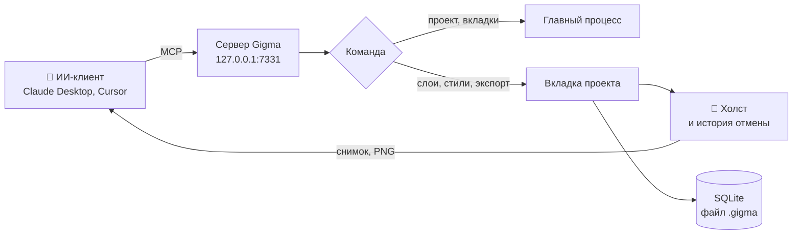
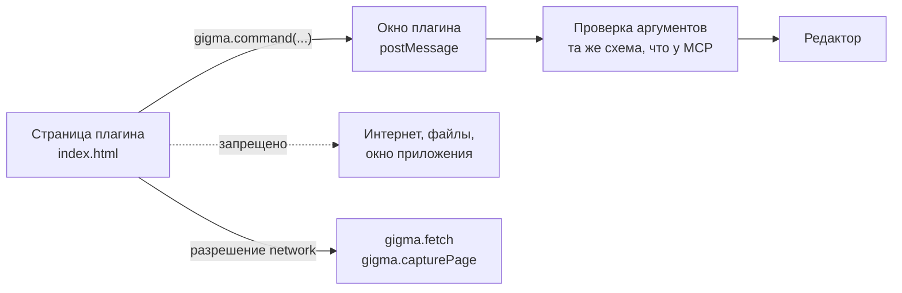
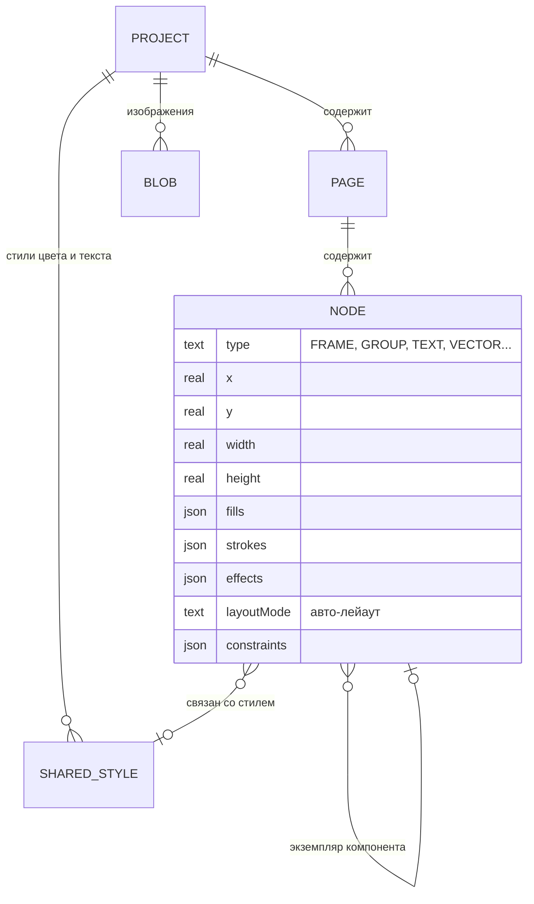
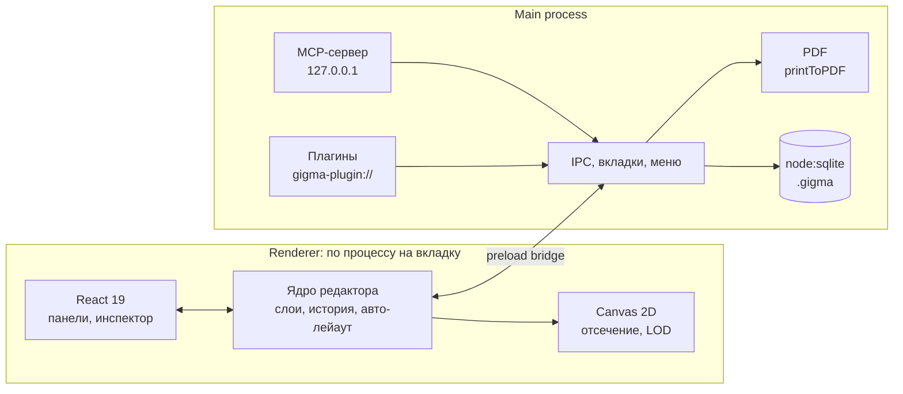

<div align="center">


<h3>Офлайн-редактор дизайна в духе Figma со встроенным MCP-сервером для ИИ</h3>

<p>
  
  
  
  
  
  
  
  
</p>

<p>
  <a href="#-быстрый-старт">Быстрый старт</a> ·
  <a href="#-возможности">Возможности</a> ·
  <a href="#-скриншоты">Скриншоты</a> ·
  <a href="#-концепция">Концепция</a> ·
  <a href="#-подключение-ии">Подключение ИИ</a> ·
  <a href="#-плагины">Плагины</a> ·
  <a href="#-архитектура">Архитектура</a>
</p>

</div>

---

## 💡 О проекте

**Gigma** это редактор интерфейсов и графики, который работает без интернета и привычен тем, кто знает Figma: те же панели, те же инструменты, те же горячие клавиши. Это не конкурент Figma, а её офлайн-компаньон: можно работать локально, в самолёте или с закрытым контуром, а потом перенести макет в Figma обычным копированием.

Главная особенность: **встроенный MCP-сервер**. ИИ-ассистент (Claude Desktop, Cursor, Claude Code и другие) подключается к запущенной Gigma и рисует прямо на вашем холсте: создаёт фреймы и слои, собирает авто-лейаут, правит стили, смотрит на результат и исправляет его. Все действия ИИ это обычные шаги истории, их можно отменить.

> Проекты хранятся локально в SQLite. Сервер слушает только `127.0.0.1`, ваши файлы никуда не отправляются.

## ✨ Возможности

<table>
<tr>
<td width="50%" valign="top">

### 🎨 Редактор как в Figma
- Холст со страницами, слоями, фреймами и секциями
- Фигуры, перо и карандаш, текст с полной типографикой
- **Авто-лейаут**: направление, отступы, поля, перенос строк, «обжать» и «заполнить»
- **Привязки** (constraints) при растягивании фрейма
- **Компоненты**, экземпляры с переопределениями и **варианты**
- **Булевы операции** и сведение в контур, маски
- Заливки: цвет, линейный и радиальный градиент, изображение
- Эффекты: тени, внутренние тени, размытие слоя и фона, 16 режимов наложения
- Связанные **стили** цвета и текста
- Линейки расстояний по Alt, умные направляющие, равные отступы
- Вкладки проектов, корзина, светлая и тёмная тема, русский и английский язык

</td>
<td width="50%" valign="top">

### 🤖 ИИ и автоматизация
- **MCP-сервер** на `127.0.0.1:7331`: 50+ инструментов, от создания фрейма до экспорта PDF
- ИИ видит холст: снимок экрана и экспорт любого слоя
- Карточки **Spec** (задания для ИИ) и аннотации прямо на холсте
- **Гайдлайны**: дизайн-системы (цвета с ролями, шрифты, логотипы, правила) в общей библиотеке для всех проектов, с экспортом и импортом `.guide.gigma`
- Блок **Code**: HTML + CSS, отрисованные как слой
- **Плагины** `.plug.gigma` в песочнице, с тем же API, что у MCP

### 📦 Обмен и экспорт
- Копирование **в Figma и из Figma**, вместе с изображениями
- Экспорт в **PNG**, **SVG** и **PDF** (вектор, текст остаётся текстом)
- «Экспорт фреймов в PDF»: все фреймы страницы одним файлом
- Формат `.gigma`: проект или отдельные страницы одним файлом, с картинками

</td>
</tr>
</table>

### ⌨️ Горячие клавиши

Те же, что в Figma, и работают на любой раскладке клавиатуры.

| Действие | Клавиши | Действие | Клавиши |
|---|---|---|---|
| Сгруппировать / разгруппировать | `Ctrl+G` / `Ctrl+Shift+G` | Обернуть во фрейм | `Ctrl+Alt+G` |
| Авто-лейаут | `Shift+A` | Создать компонент | `Ctrl+Alt+K` |
| Объединить / вычесть / пересечь / исключить | `Alt+Shift+U` / `S` / `I` / `E` | Свести в контур | `Ctrl+E` |
| Обводка в контур | `Ctrl+Alt+O` | Использовать как маску | `Ctrl+Alt+M` |
| Скрыть / заблокировать | `Ctrl+Shift+H` / `Ctrl+Shift+L` | На передний / задний план | `]` / `[` |
| Копировать / вставить свойства | `Ctrl+Alt+C` / `Ctrl+Alt+V` | Вставить с заменой | `Ctrl+Shift+R` |
| Прозрачность | `1`…`9`, `0` | Расстояния до соседей | удерживать `Alt` |
| Действия и плагины | `Ctrl+K` | Инструменты | `V` `F` `R` `O` `L` `P` `T` |

## 📸 Скриншоты

<p align="center">
  
  <br/><sub><b>Редактор:</b> слои и страницы слева, инспектор справа, инструменты снизу</sub>
</p>

<table>
<tr>
<td width="50%"><p align="center"><sub><b>Главный экран:</b> недавние проекты, избранное, корзина</sub></p></td>
<td width="50%"><p align="center"><sub><b>Авто-лейаут:</b> список сам раскладывает карточки</sub></p></td>
</tr>
<tr>
<td width="50%"><p align="center"><sub><b>Компоненты и варианты:</b> свойство <code>State</code> переключается в инспекторе</sub></p></td>
<td width="50%"><p align="center"><sub><b>Меню правого клика</b> с теми же пунктами, что в Figma</sub></p></td>
</tr>
<tr>
<td width="50%"><p align="center"><sub><b>Alt:</b> расстояния от выделения до соседнего слоя</sub></p></td>
<td width="50%"><p align="center"><sub><b>Плагин</b> в окне поверх холста меняет выделенный слой</sub></p></td>
</tr>
</table>

<details>
<summary><b>Плагины в настройках</b></summary>
<br/>

</details>

## 🧭 Концепция

### Как ИИ рисует на холсте



Каждый инструмент MCP это тонкая обёртка над **шиной команд** редактора. Той же шиной пользуются плагины, поэтому у ИИ и у плагинов одинаковые возможности и одинаковые имена команд.

### Плагин в песочнице



Плагин это обычная веб-страница в изолированном фрейме. Она не видит ни диск, ни приложение, ни сеть: всё идёт через объект `gigma`.

### Модель данных



Модель слоёв намеренно повторяет модель Figma (типы, относительные координаты, заливки и обводки списками), поэтому перенос в обе стороны проходит почти без потерь.

## 🚀 Быстрый старт

### Готовая сборка

Скачайте `Gigma-Setup-x.x.x.exe` со страницы **Releases** и запустите. Установщик на русском и английском, позволяет выбрать папку, создаёт ярлыки и связывает с Gigma файлы `.gigma`.

### Из исходников

Нужен [Node.js](https://nodejs.org) 22 или новее.

```bash
git clone https://github.com/A01L/gigma.git
cd gigma
npm install
npm run dev
```

### Сборка установщика

```bash
npm run dist:win   # Windows: dist/Gigma-Setup-x.x.x.exe
npm run dist:mac   # macOS: .dmg (собирать на macOS)
```

Оформление установщика лежит в `build/`: страницы и тексты в `installer.nsh`, картинки создаются командой `npm run installer-art`.

## 🔌 Подключение ИИ

Откройте **Настройки → ИИ (MCP)**. Сервер запускается вместе с Gigma и принимает подключения только с этого компьютера.

### Claude Desktop

Нажмите **«Скопировать конфиг Claude Desktop»**, в Claude откройте *Settings → Developer → Edit Config*, вставьте и перезапустите Claude. Отдельный Node.js не нужен: мост запускается самой Gigma.

### Клиенты с HTTP (Cursor, VS Code, Claude Code, LM Studio)

Добавьте сервер типа `http` с адресом:

```
http://127.0.0.1:7331/mcp
```

### Что умеет ИИ

| Группа | Инструменты |
|---|---|
| Проекты и страницы | `list_projects`, `create_project`, `open_project`, `list_tabs`, `switch_tab`, `list_pages`, `create_page`, `update_page` |
| Создание слоёв | `create_frame`, `create_rectangle`, `create_ellipse`, `create_text`, `create_shape`, `create_svg`, `create_image`, `create_code` |
| Инспектор целиком | `update_node`: размеры, заливки и градиенты, обводки, эффекты, типографика, авто-лейаут, привязки, стили |
| Слои | `group_nodes`, `ungroup_nodes`, `duplicate_nodes`, `reorder_nodes`, `align_nodes`, `delete_nodes` |
| Фигуры | `boolean_operation`, `flatten_nodes`, `outline_stroke` |
| Компоненты и стили | `create_component`, `create_instance`, `add_variant`, `set_variant`, `detach_instance`, `list_styles`, `create_style`, `update_style` |
| Зрение и экспорт | `get_screenshot`, `export_png`, `export_svg`, `export_pdf` |
| Чтение | `get_document`, `get_selection`, `get_node`, `find_nodes` |
| Задания | `list_specs`, `create_spec`, `update_spec`, `link_spec`, `list_annotations`, `resolve_annotation` |
| Гайдлайны | `list_guidelines`, `get_guideline`, `create_guideline`, `update_guideline`, `place_guideline`, `link_guideline` |

> 💡 Оставьте на холсте карточку **Spec** с описанием задачи: ИИ найдёт её через `list_specs`, выполнит и отметит результат. Карточка работает как нода: правый порт тянется к фреймам или секциям, где нужно работать, левый принимает материалы (фреймы с компонентами, референсы, старый дизайн). Карточка может быть заданием со статусом или набором правил, которые ИИ соблюдает при каждой правке в связанных фреймах.

## 🧩 Плагины

Плагин это файл `.plug.gigma`: zip-архив с `manifest.json` и веб-страницей. Сборщики и Node.js не нужны.

- **Установка:** Настройки → «Плагины» → «Установить плагин…», либо перетащите файл в этот раздел
- **Запуск:** правый клик → «Плагины», либо `Ctrl+K` и название
- **Свой плагин:** в том же разделе можно скачать документацию и шаблон. Документацию можно целиком отдать ИИ-ассистенту вместе с описанием идеи

```html
<link rel="stylesheet" href="/@gigma/ui.css" />
<button id="go" class="primary">Скруглить выделенное</button>
<script>
  document.getElementById('go').onclick = async () => {
    const nodes = await gigma.selection()
    await gigma.undoGroup(async () => {
      for (const n of nodes) await gigma.command('update_node', { id: n.id, cornerRadius: 16 })
    })
  }
</script>
```

Полное описание формата и API: [docs/PLUGINS.md](docs/PLUGINS.md). Упаковать папку плагина: `node scripts/pack-plugins.mjs <папка>`.

## 🔁 Совместимость с Figma

| Направление | Как работает |
|---|---|
| Gigma → Figma | `Ctrl+C` кладёт в буфер SVG, Figma вставляет его редактируемыми слоями |
| Figma → Gigma | Обычный `Ctrl+C` в Figma: читается родной формат буфера со слоями, эффектами и типографикой. Также работает «Copy as SVG» |
| Изображения из Figma | Figma не копирует сами картинки. Gigma подтягивает их по личному токену Figma (Настройки → Figma) |
| Gigma → Gigma | Тот же SVG несёт точные данные слоёв, копирование без потерь |

## 🏗️ Архитектура



```
gigma/
├── src/
│   ├── main/            главный процесс
│   │   ├── index.ts     окно, вкладки, IPC, меню
│   │   ├── storage.ts   файл .gigma (SQLite)
│   │   ├── mcp.ts       MCP-сервер и схемы команд
│   │   ├── plugins.ts   пакеты .plug.gigma, песочница
│   │   └── pdf.ts       экспорт в PDF
│   ├── preload/         безопасный мост window.gigma
│   ├── renderer/
│   │   ├── editor/      ядро: слои, холст, текст, SVG, булевы операции, буфер Figma
│   │   └── ui/          React: панели, инспектор, меню, настройки
│   └── shared/          типы документа и список команд
├── bin/gigma-mcp.cjs    мост stdio ↔ HTTP для Claude Desktop
├── build/               иконки и оформление установщика
├── scripts/             тесты через MCP, иконки, упаковка плагинов
└── docs/                архитектура, плагины, скриншоты
```

### Технологии

| Слой | Что используется | Почему |
|---|---|---|
| Оболочка | Electron 45 | Нативное окно, вкладка на процесс: тяжёлый файл не тормозит остальные |
| Хранилище | SQLite через встроенный `node:sqlite` | Без нативной сборки, проект это один файл |
| Интерфейс | React 19, TypeScript | Панели и инспектор, холст рисуется отдельно |
| Холст | Canvas 2D, пространственный индекс rbush | Отсечение невидимого и упрощение мелких слоёв на больших макетах |
| Контуры | paper.js | Точные булевы операции над кривыми |
| Буфер Figma | kiwi-schema, fzstd | Чтение родного формата буфера Figma |
| ИИ | Model Context Protocol, zod | Одна схема команд для ИИ и плагинов |
| PDF | `webContents.printToPDF` | Векторные страницы, текст остаётся текстом |

Подробнее: [docs/ARCHITECTURE.md](docs/ARCHITECTURE.md).

## 🗂️ Где хранятся данные

| Что | Где |
|---|---|
| Проекты | `%APPDATA%\Gigma\library\` (один файл `.gigma` на проект) |
| Корзина | `%APPDATA%\Gigma\library\.trash\`, очищается через 30 дней |
| Плагины | `%APPDATA%\Gigma\plugins\` |
| Настройки | `%APPDATA%\Gigma\settings.json` |

Папки проектов и плагинов открываются из **Настроек**.

## 🧪 Для разработчиков

```bash
npm run dev         # приложение в режиме разработки
npm run web         # только интерфейс в браузере, без MCP и SQLite
npm run typecheck   # проверка типов
npm run icons       # иконки из build/icon.svg
```

Тесты управляют запущенным приложением через MCP и отладочный порт:

```bash
npx electron-vite dev --remoteDebuggingPort 9333
node scripts/test-batch1.mjs       # градиенты, клавиши, меню
node scripts/test-batch2.mjs       # авто-лейаут, режимы наложения, поворот
node scripts/test-batch3.mjs       # привязки, перенос, стили, варианты
node scripts/test-boolean.mjs      # булевы операции
node scripts/test-components.mjs   # компоненты, обводка в контур
node scripts/test-pdf.mjs          # экспорт в PDF
```

## 🛣️ Планы

- [ ] Прототипирование: переходы между фреймами
- [ ] Свойства компонентов: видимость и подмена вложенного экземпляра
- [ ] Минимальные и максимальные размеры в авто-лейауте
- [ ] Текст по кривой
- [ ] Импорт стилей и компонентов из Figma
- [ ] Каталог плагинов

## 📄 Лицензия

[MIT](LICENSE)

<div align="center">
<sub>Сделано, чтобы дизайн не зависел от интернета 💜</sub>
</div>
