<div align="center">

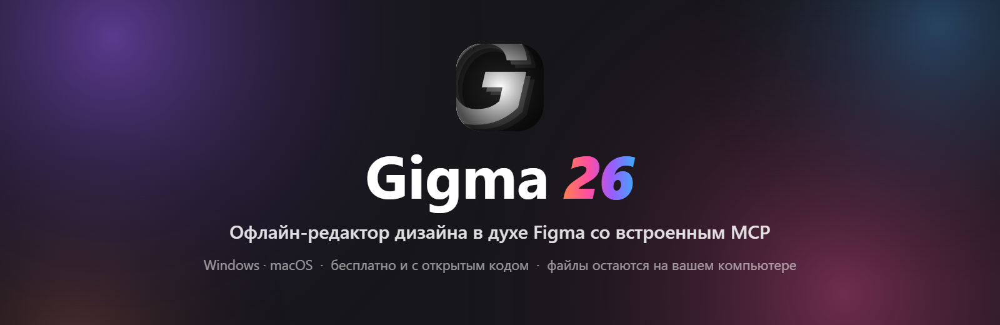

<h3>An offline, Figma-style design editor with a built-in MCP server for AI</h3>

<p>
  
  
  
  
  
  
  
  
</p>

<p>
  <a href="#quick-start">Quick start</a> ·
  <a href="#features">Features</a> ·
  <a href="#ai-nodes">AI nodes</a> ·
  <a href="#screenshots">Screenshots</a> ·
  <a href="#concept">Concept</a> ·
  <a href="#connecting-an-ai">Connecting an AI</a> ·
  <a href="#plugins">Plugins</a> ·
  <a href="#architecture">Architecture</a>
</p>

</div>

---

## About

**Gigma** is an editor for interfaces and graphics that works without the internet and feels familiar to anyone who knows Figma: the same panels, the same tools, the same shortcuts. It is not a competitor to Figma but its offline companion: work locally, on a plane or inside a closed network, then move the design to Figma with a plain copy and paste.

Its main feature is a **built-in MCP server**. An AI assistant (Claude Desktop, Cursor, Claude Code and others) connects to the running Gigma and draws right on your canvas: it creates frames and layers, builds auto layout, edits styles, looks at the result and fixes it. Everything the AI does is an ordinary step in the history and can be undone.

> Projects are stored locally in SQLite. The server listens on `127.0.0.1` only; your files are not sent anywhere.

## Features

<table>
<tr>
<td width="50%" valign="top">

### An editor like Figma
- Canvas with pages, layers, frames and sections
- Shapes, pen and pencil, text with full typography
- **Point editing** on double click: its own tools (pen, bend, paint bucket), snapping and the hatch over the shape, as in Figma
- **Auto layout**: direction, gaps, padding, wrapping, hug and fill
- **Constraints** when a frame is resized
- **Components**, instances with overrides and **variants**
- **Text to outlines**: Outline stroke (`Ctrl+Alt+O`) or Flatten on a text turns its glyphs into one vector path, read from the fonts installed on the computer
- **Stroke settings** as in Figma: solid or dashed (dash, gap, dash cap), start and end points of an open path (round, square, line / triangle / reversed triangle / circle / diamond arrows), join (miter, bevel, round) with the miter angle, and a width profile (taper, lens, wedge). They are kept by the SVG / PDF export and by Outline stroke
- **Boolean operations** and flatten, masks (a shape cuts by its outline; a picture, a text or a group by its alpha, as in Figma)
- Corner radius on the canvas: a dot in each corner of a rectangle or a frame (Alt = one corner), one for a polygon or a star; rounding never gets squashed when the shape is squeezed
- Fills: colour, linear / radial / angular / diamond gradient, image (cropped images from Figma keep their crop); a fill popover like Figma's (Hex, RGB, HSL, HSB, CSS, eyedropper, colours of the page)
- Gradients are edited as in Figma: a bar of colour stops and their list in the popover, flip and rotate, and handles right on the canvas (start, end, width, stops; a press on the line adds a stop, Delete removes it, Shift snaps to 15°)
- The name over a frame turns with the frame; a double click on it renames the frame in place
- Effects: shadows, inner shadows, layer and background blur, 16 blend modes
- Linked colour and text **styles**
- Distances on Alt, smart guides, equal spacing as in Figma: the gaps between the layers around are a pattern, a dragged layer snaps where its own gap repeats one of them, and every gap of that size is marked with its value
- Project tabs, trash, light and dark theme, English and Russian interface
- The layers panel and the inspector can be widened by dragging their edge

</td>
<td width="50%" valign="top">

### AI and automation
- **MCP server** on `127.0.0.1:7331`: 60+ tools, from creating a frame to exporting a PDF
- The AI sees the canvas: a screenshot and an export of any layer
- **Spec** cards as nodes: the right port leads to the frames to work in, the left port takes materials; a card is a task or a set of standing rules
- A task board on Home: the Spec tasks of every open project grouped into in progress, queue and done, with a progress bar in the sidebar; a click jumps to the task on its canvas
- **AI cursor**: shows which client (Claude, Codex and others) is working and on which layer
- Annotations right on the canvas
- **Guidelines**: design systems (colours with roles, fonts, logos, rules) in a library shared by every project, exported and imported as `.gguide`
- **Code** block: HTML + CSS rendered as a layer
- Sandboxed **plugins** (`.gplug`) with the same API as MCP

### Exchange and export
- Copy **to Figma and from Figma**, images included
- **PDF import**: drop a PDF on the canvas and every page becomes a frame, with its text, shapes and pictures as separate layers
- Export to **PNG**, **SVG** and **PDF** (vector, text stays text)
- Batch export: several selected layers become a file each (named after the layer) in a folder you choose; one layer opens a Save dialog
- "Export frames to PDF": every frame of a page in one file
- The `.gigma` format: a project or selected pages in one file, with images

</td>
</tr>
</table>

### Shortcuts

The same as in Figma, and they work on any keyboard layout.

| Action | Keys | Action | Keys |
|---|---|---|---|
| Group / ungroup | `Ctrl+G` / `Ctrl+Shift+G` | Frame selection | `Ctrl+Alt+G` |
| Auto layout | `Shift+A` | Create component | `Ctrl+Alt+K` |
| Union / subtract / intersect / exclude | `Alt+Shift+U` / `S` / `I` / `E` | Flatten | `Ctrl+E` |
| Outline stroke | `Ctrl+Alt+O` | Use as mask | `Ctrl+Alt+M` |
| Hide / lock | `Ctrl+Shift+H` / `Ctrl+Shift+L` | Bring forward / send backward | `]` / `[` |
| Copy / paste properties | `Ctrl+Alt+C` / `Ctrl+Alt+V` | Paste to replace | `Ctrl+Shift+R` |
| Opacity | `1`…`9`, `0` | Distances to neighbours | hold `Alt` |
| Actions and plugins | `Ctrl+K` | Guidelines | `Ctrl+Shift+U` |
| Tools | `V` `F` `R` `O` `L` `P` `T` | Edit points | double click |

## AI nodes

<p align="center">
  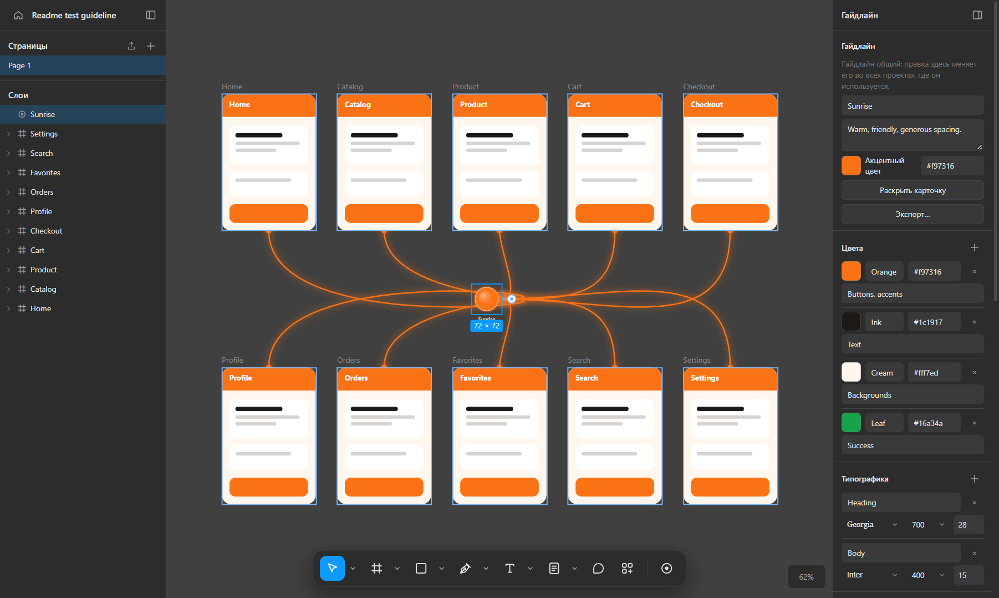
  <br/><sub><b>Guideline:</b> one design system (colours with roles, fonts, logos, rules) wired to ten screens. An AI working in any of them knows what it has to look like. Editing the guideline changes it in every project</sub>
</p>

<table>
<tr>
<td width="50%">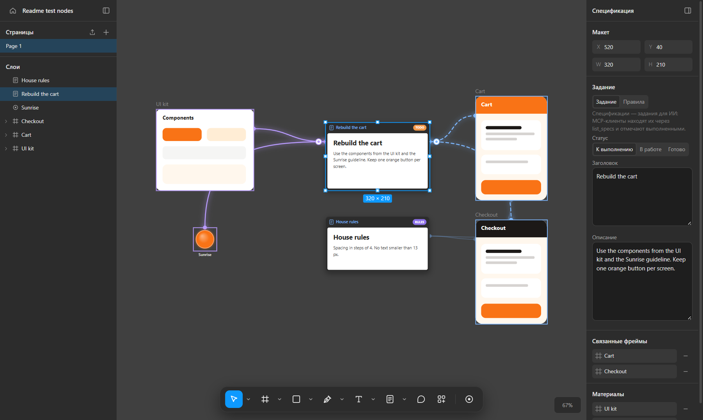<p align="center"><sub><b>Spec as a node:</b> materials come in on the left (a UI kit and a guideline), the screens to work in go out on the right. Below it, a card with standing rules</sub></p></td>
<td width="50%">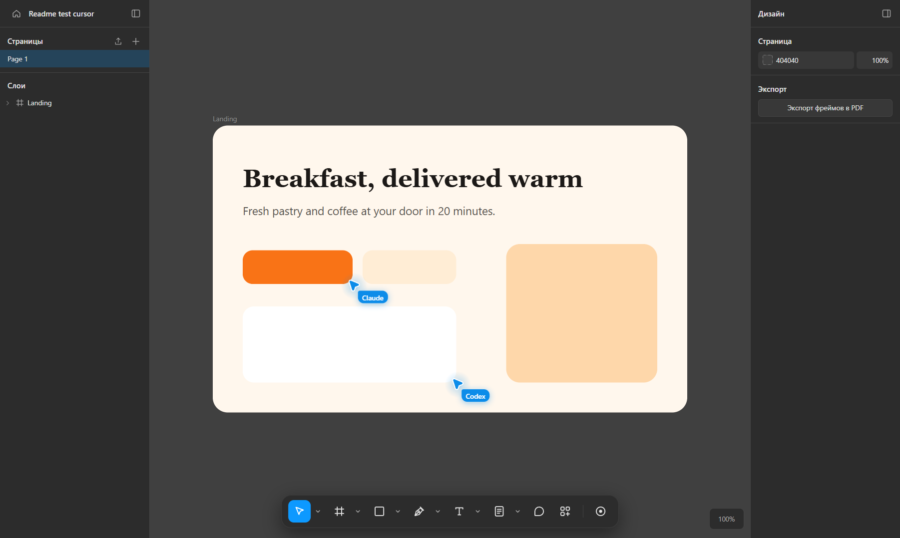<p align="center"><sub><b>AI cursor:</b> two clients work at once; each one is signed and sits at the layer it has just created</sub></p></td>
</tr>
</table>

How the pieces work together:

1. Put a brand into a **guideline** (the toolbar button or <code>Ctrl+Shift+U</code>). It lives in a shared library, is available in every project and travels as a <code>.gguide</code> file.
2. Place its dot on the canvas and pull a wire to the screens. The colours and fonts of the guideline become styles of the project.
3. Add a **Spec** card, connect materials on its left and the target frames or sections on its right.
4. Ask the AI to do the task. It sees the materials, the rules and the place to work in, and you see its cursor on the canvas.

## Screenshots

<p align="center">
  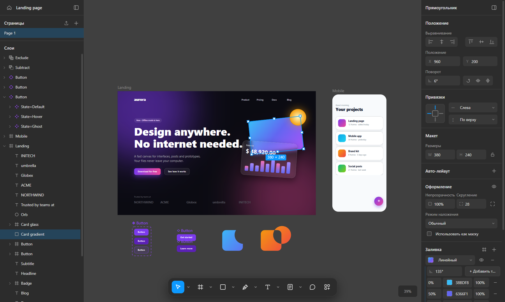
  <br/><sub><b>Editor:</b> layers and pages on the left, the inspector on the right, tools at the bottom</sub>
</p>

<table>
<tr>
<td width="50%">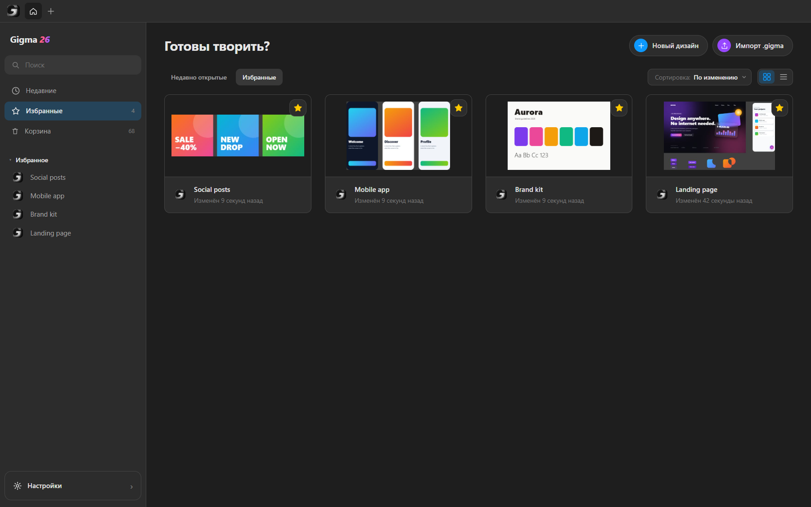<p align="center"><sub><b>Home:</b> recent projects, favourites, trash</sub></p></td>
<td width="50%">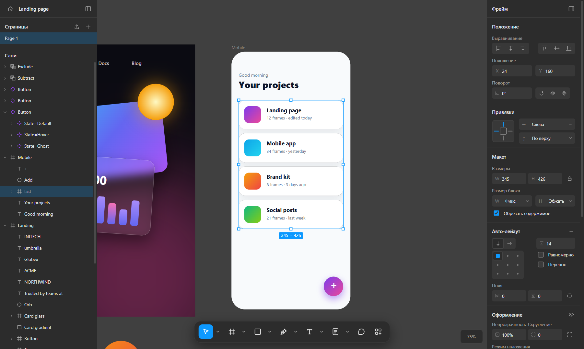<p align="center"><sub><b>Auto layout:</b> the list arranges its cards by itself</sub></p></td>
</tr>
<tr>
<td width="50%">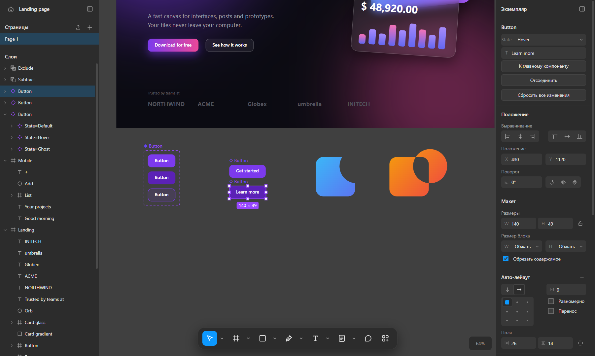<p align="center"><sub><b>Components and variants:</b> the <code>State</code> property is switched in the inspector</sub></p></td>
<td width="50%">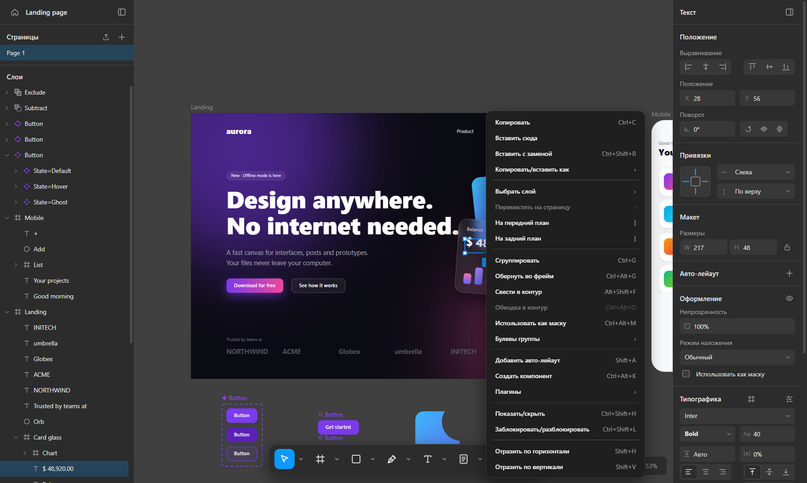<p align="center"><sub><b>Right-click menu</b> with the same items as in Figma</sub></p></td>
</tr>
<tr>
<td width="50%">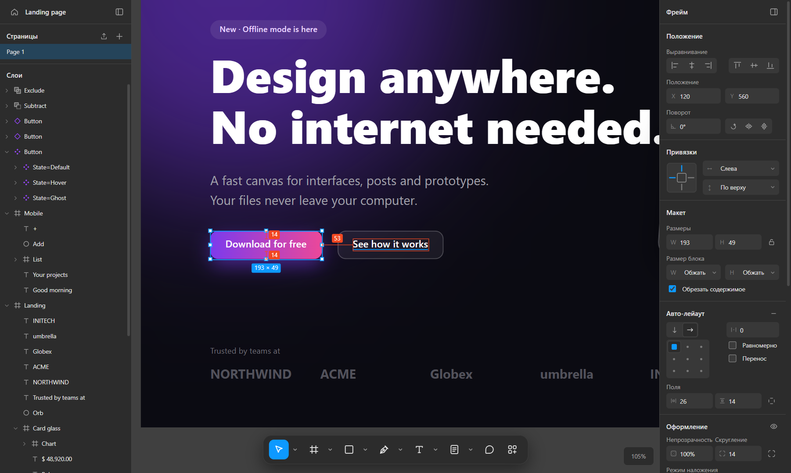<p align="center"><sub><b>Alt:</b> distances from the selection to a neighbouring layer</sub></p></td>
<td width="50%">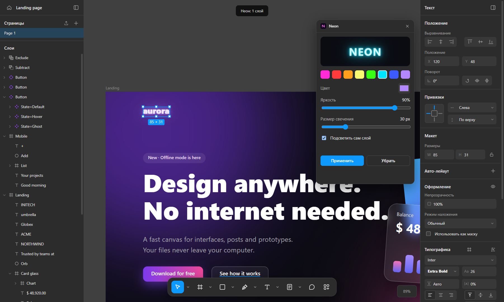<p align="center"><sub><b>A plugin</b> in a window over the canvas changes the selected layer</sub></p></td>
</tr>
<tr>
<td width="50%">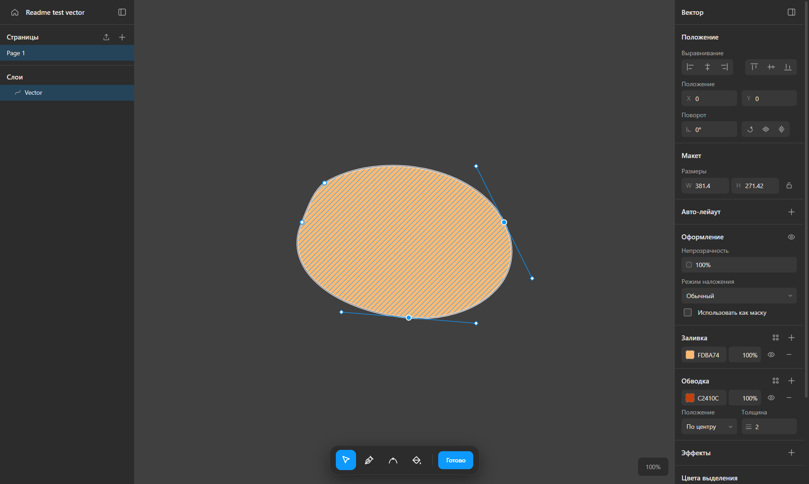<p align="center"><sub><b>Point editing:</b> a double click opens the outline; the mode has its own toolbar</sub></p></td>
<td width="50%">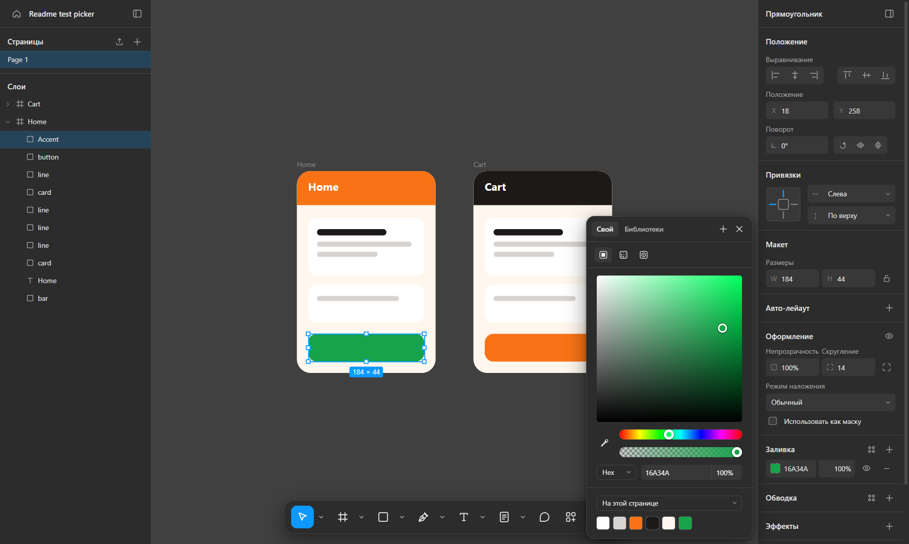<p align="center"><sub><b>Fill popover</b> with formats, an eyedropper and the colours of the page</sub></p></td>
</tr>
</table>

<details>
<summary><b>Plugins in Settings</b></summary>
<br/>
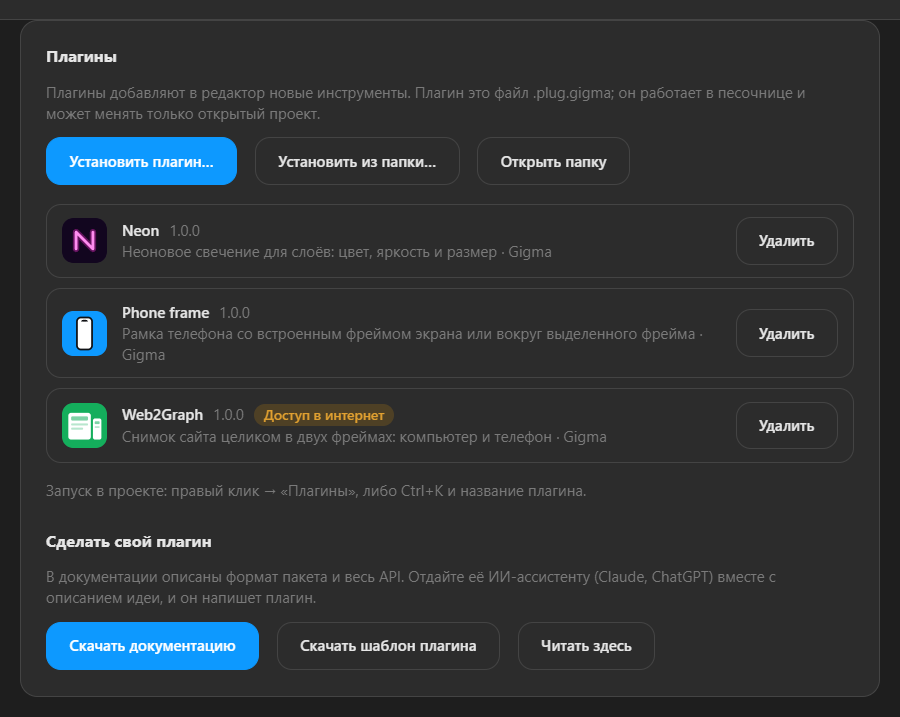
</details>

## Concept

### How an AI draws on the canvas

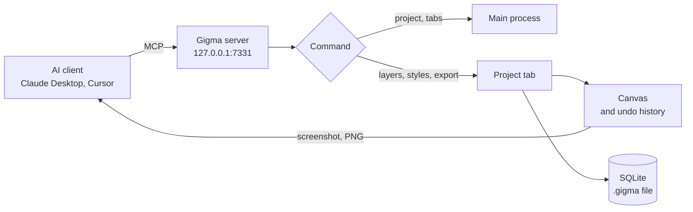

Every MCP tool is a thin wrapper around the editor's **command bus**. Plugins use the same bus, so the AI and plugins have the same abilities and the same command names.

### A plugin in the sandbox

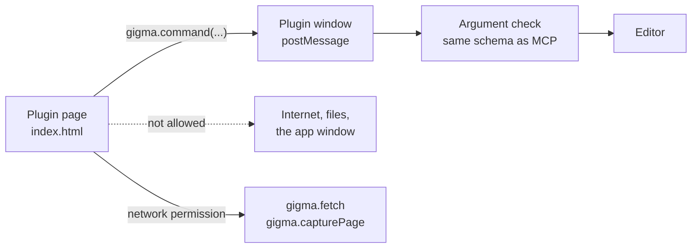

A plugin is an ordinary web page in an isolated frame. It sees neither the disk, nor the application, nor the network: everything goes through the `gigma` object.

### Data model

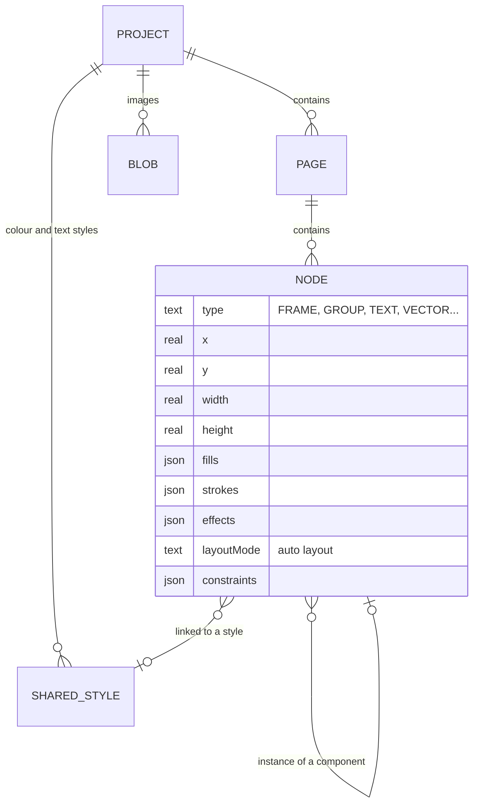

The layer model deliberately mirrors Figma's (types, coordinates relative to the parent, fills and strokes as lists), so moving a design in either direction loses almost nothing.

## Quick start

### Ready-made build

Download `Gigma-Setup-x.x.x.exe` from the **Releases** page and run it. The installer is in English and Russian, lets you choose the folder, creates shortcuts and associates `.gigma`, `.gguide` and `.gplug` files with Gigma.

### From source

You need [Node.js](https://nodejs.org) 22 or newer.

```bash
git clone https://github.com/A01L/gigma.git
cd gigma
npm install
npm run dev
```

### Building the installer

```bash
npm run dist:win   # Windows: dist/Gigma-Setup-x.x.x.exe
npm run dist:mac   # macOS: .dmg (build on macOS)
```

The look of the installer lives in `build/`: pages and texts in `installer.nsh`, the artwork is generated with `npm run installer-art`.

## Connecting an AI

Open **Settings → AI (MCP)**. The server starts together with Gigma and accepts connections from this computer only.

### Claude Desktop

Press **"Copy Claude Desktop config"**, in Claude open *Settings → Developer → Edit Config*, paste it and restart Claude. No separate Node.js is needed: the bridge is run by Gigma itself.

### HTTP clients (Cursor, VS Code, Claude Code, LM Studio)

Add a server of type `http` with the address:

```
http://127.0.0.1:7331/mcp
```

### What the AI can do

| Group | Tools |
|---|---|
| Projects and pages | `list_projects`, `create_project`, `open_project`, `list_tabs`, `switch_tab`, `list_pages`, `create_page`, `update_page` |
| Creating layers | `create_frame`, `create_rectangle`, `create_ellipse`, `create_text`, `create_shape`, `create_svg`, `create_image`, `create_code` |
| The whole inspector | `update_node`: size, fills and gradients, strokes, effects, typography, auto layout, constraints, styles |
| Layers | `group_nodes`, `ungroup_nodes`, `duplicate_nodes`, `reorder_nodes`, `align_nodes`, `delete_nodes` |
| Shapes | `boolean_operation`, `flatten_nodes`, `outline_stroke` |
| Components and styles | `create_component`, `create_instance`, `add_variant`, `set_variant`, `detach_instance`, `list_styles`, `create_style`, `update_style` |
| Seeing and exporting | `get_screenshot`, `export_png`, `export_svg`, `export_pdf` |
| Reading | `get_document`, `get_selection`, `get_node`, `find_nodes` |
| Tasks | `list_specs`, `create_spec`, `update_spec`, `link_spec`, `list_annotations`, `resolve_annotation` |
| Guidelines | `list_guidelines`, `get_guideline`, `create_guideline`, `update_guideline`, `place_guideline`, `link_guideline`, `get_guideline_image`, `place_guideline_image` |

> Leave a **Spec** card on the canvas with a description of the task: the AI finds it with `list_specs`, does the work and records the result. The card works as a node: its right port is pulled to the frames or sections to work in, its left port takes materials (frames with components, references, an old design). A card is either a task with a status or a set of rules the AI follows on every edit in the linked frames.

## Plugins

A plugin is a `.gplug` file: a zip archive with a `manifest.json` and a web page. No bundlers and no Node.js are needed.

- **Install:** Settings → "Plugins" → "Install plugin…", or drop the file onto that section
- **Run:** right click → "Plugins", or `Ctrl+K` and the name
- **Your own plugin:** the same section offers the documentation and a starter template. The documentation can be handed to an AI assistant as a whole, together with your idea

```html
<link rel="stylesheet" href="/@gigma/ui.css" />
<button id="go" class="primary">Round the selection</button>
<script>
  document.getElementById('go').onclick = async () => {
    const nodes = await gigma.selection()
    await gigma.undoGroup(async () => {
      for (const n of nodes) await gigma.command('update_node', { id: n.id, cornerRadius: 16 })
    })
  }
</script>
```

The full description of the format and the API (in Russian): [docs/PLUGINS.md](docs/PLUGINS.md). To pack a plugin folder: `node scripts/pack-plugins.mjs <folder>`.

## Figma compatibility

| Direction | How it works |
|---|---|
| Gigma → Figma | `Ctrl+C` puts SVG on the clipboard; Figma pastes it as editable layers |
| Figma → Gigma | A plain `Ctrl+C` in Figma: the native clipboard format is read, with layers, effects and typography. "Copy as SVG" works too |
| Images from Figma | Figma does not copy the pictures themselves. Gigma fetches them with a personal Figma token (Settings → Figma) |
| Gigma → Gigma | The same SVG carries the exact layer data, so nothing is lost |

## Architecture

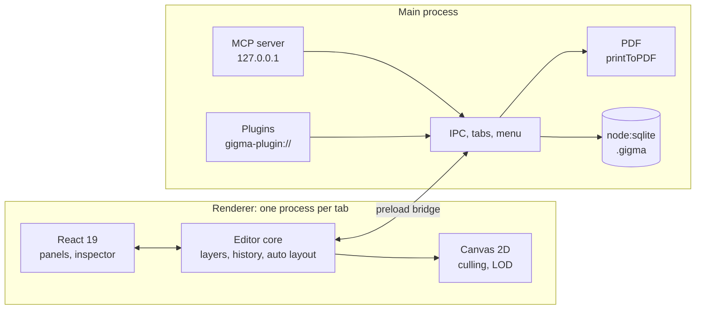

```
gigma/
├── src/
│   ├── main/            main process
│   │   ├── index.ts     window, tabs, IPC, menu
│   │   ├── storage.ts   the .gigma file (SQLite)
│   │   ├── mcp.ts       MCP server and command schemas
│   │   ├── guides.ts    guideline library (.gguide)
│   │   ├── plugins.ts   .gplug packages, the sandbox
│   │   └── pdf.ts       PDF export
│   ├── preload/         the safe window.gigma bridge
│   ├── renderer/
│   │   ├── editor/      core: layers, canvas, text, SVG, boolean operations, point editing, Figma clipboard
│   │   └── ui/          React: panels, inspector, menus, settings
│   └── shared/          document types and the command list
├── bin/gigma-mcp.cjs    stdio ↔ HTTP bridge for Claude Desktop
├── build/               icons and installer artwork
├── scripts/             tests over MCP, icons, plugin packing
└── docs/                architecture, plugins, screenshots
```

### Technology

| Layer | What is used | Why |
|---|---|---|
| Shell | Electron 45 | A native window and a process per tab: a heavy file does not slow the others down |
| Storage | SQLite through the built-in `node:sqlite` | No native build; a project is a single file |
| Interface | React 19, TypeScript | Panels and the inspector; the canvas is drawn separately |
| Canvas | Canvas 2D, the rbush spatial index | Culling of what is not visible and simplified small layers on large designs |
| Outlines | paper.js | Exact boolean operations on curves |
| Figma clipboard | kiwi-schema, fzstd | Reading Figma's native clipboard format |
| AI | Model Context Protocol, zod | One command schema for the AI and for plugins |
| PDF | `webContents.printToPDF` | Vector pages, text stays text |

More: [docs/ARCHITECTURE.md](docs/ARCHITECTURE.md).

## Where data is stored

| What | Where |
|---|---|
| Projects | `%APPDATA%\Gigma\library\` (one `.gigma` file per project) |
| Trash | `%APPDATA%\Gigma\library\.trash\`, emptied after 30 days |
| Guidelines | `%APPDATA%\Gigma\library\guides\` (one `.gguide` file per guideline) |
| Plugins | `%APPDATA%\Gigma\plugins\` |
| Settings | `%APPDATA%\Gigma\settings.json` |

The project and plugin folders can be opened from **Settings**.

## For developers

```bash
npm run dev         # the app in development mode
npm run web         # the interface alone in a browser, without MCP and SQLite
npm run typecheck   # type check
npm run icons       # icons from the SVGs in build/
```

The tests drive a running app through MCP and the debugging port:

```bash
npx electron-vite dev --remoteDebuggingPort 9333
node scripts/test-batch1.mjs        # gradients, keys, menus
node scripts/test-batch2.mjs        # auto layout, blend modes, rotation
node scripts/test-batch3.mjs        # constraints, wrapping, styles, variants
node scripts/test-boolean.mjs       # boolean operations
node scripts/test-components.mjs    # components, outline stroke
node scripts/test-pdf.mjs           # PDF export
node scripts/test-undo.mjs          # undo and redo on any keyboard layout
node scripts/test-specs.mjs         # Spec cards as nodes
node scripts/test-spec-board.mjs    # the task board on Home
node scripts/test-text-tool.mjs     # the text tool, with a real mouse
node scripts/test-pdf-import.mjs    # PDF pages into frames and layers
node scripts/test-guides.mjs        # guideline library
node scripts/test-ai-cursor.mjs     # AI cursor
node scripts/test-vector-edit.mjs   # point editing
node scripts/test-colorpicker.mjs   # fill popover
node scripts/test-panels.mjs        # resizable side panels
```

## Roadmap

- [ ] Prototyping: transitions between frames
- [ ] Component properties: visibility and swapping a nested instance
- [ ] Minimum and maximum sizes in auto layout
- [ ] Text on a path
- [ ] Importing styles and components from Figma
- [ ] A plugin catalogue

## License

[MIT](LICENSE)

<div align="center">
<sub>Made so that design does not depend on the internet</sub>
</div>
